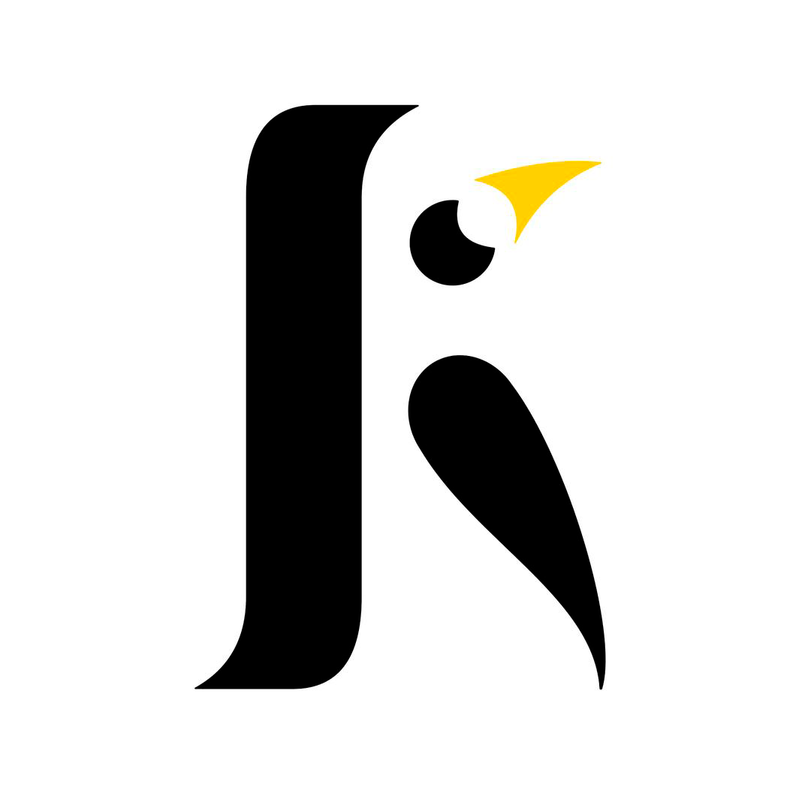

# KoreStock Ledger

Sistema para gestionar tu negocio: controla el abastecimiento de
productos y te ayuda a decidir qué comprar y en qué dejar de invertir.
Para tiendas, talleres, abarrotes, bodegas, servicios de paquetería y
negocios similares.

🔗 [App en vivo](https://korestock.kitsotaro.com)

Corre en tu navegador, sin servidor propio, y guarda tus datos en una
hoja de Google Sheets dentro de tu propio Google Drive.

## Código disponible (Source Available)

KoreStock es código disponible: puedes leer cómo funciona para confiar
en lo que hace con tus datos, pero el código y la marca pertenecen a su
autor, con todos los derechos reservados. No se permite copiarlo,
redistribuirlo ni usarlo para ofrecer otro servicio. Si quieres una
licencia comercial, escríbenos. Detalles en [`LICENSE`](./LICENSE).

## ✨ Qué hace (versión 3)

- **Venta y Entrada** — tickets con varios productos, cantidades por
  unidad o por mayoreo (caja, fardo, sixpack…), bonificaciones, sabores,
  clientes y precio de compra y de venta por unidad y por empaque.
- **Stock** — semáforo por producto, valor de bodega neto y real, total
  por mayoreo y por unidad, gráfico por marca → producto → presentación →
  sabor, editar productos y ajustar con un conteo físico.
- **Dashboard** — lo vendido hoy, movimientos por ticket con buscador
  que suma lo filtrado, anular y revertir; resumen con tendencia,
  rankings y unidades del período.
- **Panorama** — ROI y rotación, punto de equilibrio, agotamiento,
  costo promedio (las bonificaciones salen primero) y combustible.
- **Gastos, Combustible y Clientes** — con sus propios historiales.
- **Tus datos a salvo** — respaldo diario en tu carpeta de Drive, copia
  descargable en Excel, restauración verificada y archivo histórico
  cada 6 meses para seguir rápida.
- **Actualiza desde la versión anterior** — un asistente lleva tus
  datos de la versión 2 a una base nueva y comprueba que todo cuadre;
  tu base anterior queda intacta.
- **Sin conexión, solo lectura**, modos Bodega / Tienda / Pro, tema
  claro y oscuro, instalable como app (PWA) y pensada primero para el
  teléfono.

La versión anterior (KoreStock básico) sigue disponible un tiempo en
[`/v2/`](https://korestock.kitsotaro.com/v2/); usa su propio archivo
(`StockCentral_DB`) y no se cruza con la versión 3 (`KoreStock_DB`).

## 🧱  Stack técnico

JavaScript, HTML y CSS puros, sin frameworks ni compilación; librerías
propias en `lib/`. Tu "base de datos" es una hoja de Google Sheets en tu
propio Drive, que la app lee y escribe desde tu navegador con las APIs
de Google; el dinero se calcula con enteros exactos. Pruebas en
`pruebas/` (`node pruebas/ejecutar.js`).

## 📄 Licencia, privacidad y términos

- [`LICENSE`](./LICENSE) — derechos sobre el código.
- [`PRIVACY.md`](./PRIVACY.md) — qué datos toca la app y quién los ve.
- [`TERMS.md`](./TERMS.md) — términos de uso de la aplicación.

## Autor

© 2026 KoreStock Ledger — un proyecto de Kitsótaro.
